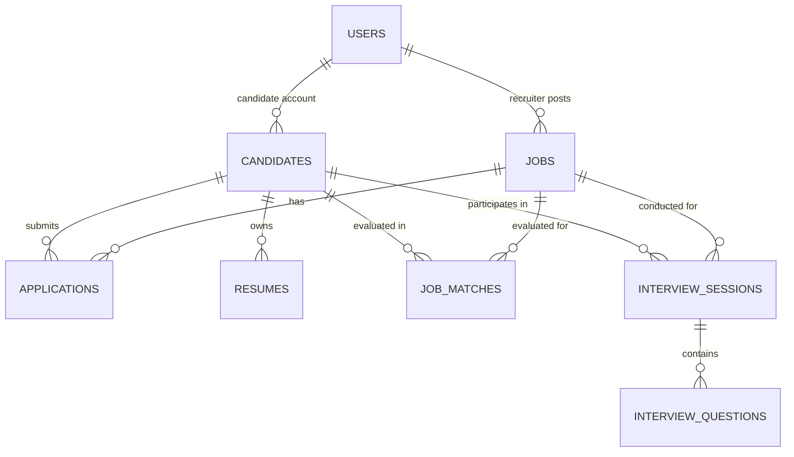

# TalentIQ — PostgreSQL Database Schema

## Entity Relationship Overview
The schema is normalized for high data integrity, transactional consistency, and fast indexing on recruitment pipelines.

## Tables & Columns

### 1. `users`
| Column | Type | Constraints | Description |
|---|---|---|---|
| id | BIGSERIAL | PRIMARY KEY | Unique user ID |
| email | VARCHAR(120) | UNIQUE, NOT NULL | Login credential |
| password | VARCHAR(255) | NOT NULL | BCrypt hash |
| full_name | VARCHAR(120) | NOT NULL | Full name |
| role | VARCHAR(20) | NOT NULL | RECRUITER or CANDIDATE |
| phone | VARCHAR(30) | NULL | Contact phone number |
| created_at | TIMESTAMP | NOT NULL | Record creation date |
| updated_at | TIMESTAMP | NULL | Last profile update |

### 2. `jobs`
| Column | Type | Constraints | Description |
|---|---|---|---|
| id | BIGSERIAL | PRIMARY KEY | Unique job ID |
| recruiter_id | BIGINT | NOT NULL, FK | Recruiter who posted the position |
| title | VARCHAR(150) | NOT NULL | Position title |
| department | VARCHAR(100) | NULL | Engineering, Product, etc. |
| location | VARCHAR(100) | NULL | Remote, City, Hybrid |
| job_type | VARCHAR(50) | NOT NULL | FULL_TIME, CONTRACT, INTERNSHIP |
| experience_min | INT | DEFAULT 0 | Minimum required years of exp |
| experience_max | INT | DEFAULT 10 | Maximum preferred years of exp |
| required_skills | TEXT | NOT NULL | JSON array of required skills |
| description | TEXT | NOT NULL | Job description & responsibilities |
| status | VARCHAR(20) | NOT NULL | ACTIVE, ARCHIVED, DRAFT |
| created_at | TIMESTAMP | NOT NULL | Creation date |
| updated_at | TIMESTAMP | NULL | Update date |

### 3. `candidates`
| Column | Type | Constraints | Description |
|---|---|---|---|
| id | BIGSERIAL | PRIMARY KEY | Unique candidate profile ID |
| user_id | BIGINT | NULL, FK | Associated candidate user account |
| full_name | VARCHAR(120) | NOT NULL | Full name |
| email | VARCHAR(120) | NOT NULL | Contact email |
| phone | VARCHAR(30) | NULL | Phone number |
| current_title | VARCHAR(150) | NULL | Current job title / role |
| years_of_experience | DOUBLE PRECISION | DEFAULT 0.0 | Total years of experience |
| location | VARCHAR(100) | NULL | Candidate residence/city |
| summary | TEXT | NULL | Candidate biography / overview |
| created_at | TIMESTAMP | NOT NULL | Profile creation date |

### 4. `resumes`
| Column | Type | Constraints | Description |
|---|---|---|---|
| id | BIGSERIAL | PRIMARY KEY | Unique resume file ID |
| candidate_id | BIGINT | NOT NULL, FK | Candidate owner |
| file_name | VARCHAR(255) | NOT NULL | Original PDF filename |
| file_type | VARCHAR(50) | NOT NULL | MIME type |
| file_size | BIGINT | NOT NULL | File size in bytes |
| raw_text | TEXT | NOT NULL | Extracted text from PDFBox |
| parsed_skills | TEXT | NULL | JSON array of extracted skills |
| parsed_experience | TEXT | NULL | JSON array of extracted job histories |
| parsed_education | TEXT | NULL | JSON array of degrees & colleges |
| parsed_projects | TEXT | NULL | JSON array of projects & technologies |
| strengths | TEXT | NULL | JSON array of identified strengths |
| missing_info | TEXT | NULL | JSON array of gaps / missing fields |
| created_at | TIMESTAMP | NOT NULL | Upload timestamp |

### 5. `applications`
| Column | Type | Constraints | Description |
|---|---|---|---|
| id | BIGSERIAL | PRIMARY KEY | Unique application ID |
| job_id | BIGINT | NOT NULL, FK | Targeted job opening |
| candidate_id | BIGINT | NOT NULL, FK | Applying candidate |
| status | VARCHAR(30) | NOT NULL | APPLIED, SCREENED, SHORTLISTED, INTERVIEW_SCHEDULED, OFFERED, REJECTED |
| stage | VARCHAR(50) | NOT NULL | Sourcing, Phone Screen, Tech Round, Offer |
| recruiter_notes | TEXT | NULL | Confidential recruiter notes |
| created_at | TIMESTAMP | NOT NULL | Application date |
| updated_at | TIMESTAMP | NULL | Pipeline transition date |

### 6. `job_matches`
| Column | Type | Constraints | Description |
|---|---|---|---|
| id | BIGSERIAL | PRIMARY KEY | Unique match assessment ID |
| job_id | BIGINT | NOT NULL, FK | Job reference |
| candidate_id | BIGINT | NOT NULL, FK | Candidate reference |
| resume_id | BIGINT | NOT NULL, FK | Resume reference |
| overall_score | INT | NOT NULL | 0-100 composite match score |
| matched_skills | TEXT | NOT NULL | JSON array of matching skills |
| missing_skills | TEXT | NOT NULL | JSON array of missing required skills |
| experience_score | INT | NOT NULL | 0-100 experience alignment score |
| skills_score | INT | NOT NULL | 0-100 technical skills score |
| explanation | TEXT | NOT NULL | Plain-English explainability text |
| resume_evidence | TEXT | NOT NULL | JSON array of verbatim resume quotes |
| created_at | TIMESTAMP | NOT NULL | Match evaluation date |

### 7. `interview_sessions`
| Column | Type | Constraints | Description |
|---|---|---|---|
| id | BIGSERIAL | PRIMARY KEY | Unique interview session ID |
| job_id | BIGINT | NOT NULL, FK | Position being interviewed for |
| candidate_id | BIGINT | NOT NULL, FK | Candidate being interviewed |
| recruiter_id | BIGINT | NOT NULL, FK | Interviewer / Recruiter |
| title | VARCHAR(200) | NOT NULL | e.g. "Senior Backend Technical Round" |
| status | VARCHAR(30) | NOT NULL | SCHEDULED, IN_PROGRESS, COMPLETED, CANCELLED |
| scheduled_at | TIMESTAMP | NULL | Scheduled interview time |
| overall_feedback | TEXT | NULL | Comprehensive interviewer summary |
| competency_score | INT | NULL | 0-100 technical rating |
| strengths | TEXT | NULL | JSON array of verified strengths |
| improvement_areas | TEXT | NULL | JSON array of areas for improvement |
| learning_recommendations | TEXT | NULL | JSON array of personalized resources |
| created_at | TIMESTAMP | NOT NULL | Session creation date |

### 8. `interview_questions`
| Column | Type | Constraints | Description |
|---|---|---|---|
| id | BIGSERIAL | PRIMARY KEY | Unique question ID |
| session_id | BIGINT | NOT NULL, FK | Associated interview session |
| difficulty | VARCHAR(20) | NOT NULL | BEGINNER, INTERMEDIATE, ADVANCED |
| category | VARCHAR(100) | NOT NULL | e.g. System Design, Spring Boot, SQL |
| question | TEXT | NOT NULL | Technical question prompt |
| expected_answer | TEXT | NOT NULL | Expected key concepts and answer points |
| follow_up | TEXT | NULL | Probing follow-up question |
| candidate_answer | TEXT | NULL | Captured notes on candidate response |
| recruiter_rating | INT | NULL | Score (1-5) |
| is_ai_generated | BOOLEAN | DEFAULT TRUE | AI generated flag |
